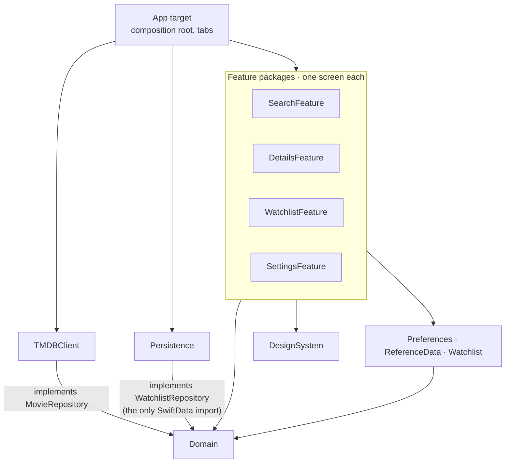
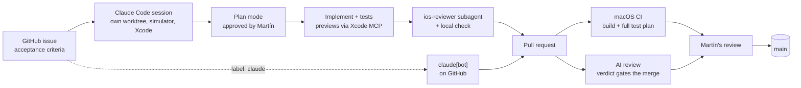

# StreamIn

**Where can I stream this movie — here, or on the services I already pay for abroad?**

[](https://github.com/martingarcialopez/StreamIn/actions/workflows/ci.yml)


StreamIn is a native iPhone and iPad app. Search a movie and it tells you, at a
glance, whether you can watch it tonight: on your services or a free one at
home, or on *your* services in another country (the VPN use case). English and
Spanish. **App Store release is the next milestone.**

<table>
  <tr>
    <th width="33%">🍿 Watch now</th>
    <th width="33%">🌍 On your services abroad</th>
    <th width="33%">📖 Go read a book</th>
  </tr>
  <tr>
    <td width="33%" align="center"></td>
    <td width="33%" align="center"></td>
    <td width="33%" align="center"></td>
  </tr>
  <tr>
    <td align="center">One of your services, or a free one, has it in your country.</td>
    <td align="center">Not at home, but your services carry it in other countries.</td>
    <td align="center">Not on your services, here or abroad.</td>
  </tr>
</table>

## In 30 seconds

StreamIn is two projects in one: **a production-quality SwiftUI app**, and **a
lab for building software with AI agents without lowering the bar.**

| | |
|---|---|
| 🏗️ **Architecture** | 11 Swift packages, one per layer. Features can't import the network client or SwiftData: it doesn't compile. |
| ⚡ **Swift concurrency** | Swift 6.2 strict concurrency, async/await end to end, no Combine. `async let` and task-group fan-outs, cancellation, actors. |
| 🧪 **Quality gates** | 222 Swift Testing tests. Every PR builds and tests on a clean macOS runner, gets an AI review whose verdict gates the merge, and a human review. |
| 🤖 **AI workflow** | Built with Claude Code: issue-driven, parallel agents in their own worktrees, a reviewer subagent, skills, hooks and an Xcode MCP server — all versioned in this repo. |
| 📏 **Measured, not claimed** | A [workflow log](docs/workflow-log.md) records every workflow change and what it actually improved, including what failed. |

## What's inside the app

- **Search** with each result's streaming services in your region filling in
  row by row as their answers arrive.
- **Details** that leads with one verdict, then shows where else it streams:
  a spinning globe and the countries that carry it for each of your services,
  popular VPN countries first.
- **Watchlist** saved with SwiftData: tap the heart, swipe to delete, and saved
  movies open complete even offline.
- **Onboarding and Settings** to pick your services (at home or worldwide),
  your region and the app's language.
- **English and Spanish**, switchable in the app; the language also drives the
  movie data.

## Engineering highlights

### One package per layer, enforced by the compiler



**Features depend on Domain protocols, never on TMDBClient or SwiftData.** A
feature's `Package.swift` doesn't list them, so the rule can't be broken by
accident. The app is testable without a network and the data source is
swappable. `StreamInApp.init()` is the only place concrete types are built: no
DI framework, dependencies go through `init`.

| Package | Holds |
|---|---|
| `Domain` | Entities, value types (`Region`, `Language`, typed IDs), `MovieRepository`, `WatchlistRepository`, typed `MovieError` |
| `TMDBClient` | HTTP client, DTOs, the TMDB adapter and the caching decorator |
| `Persistence` | A versioned SwiftData schema behind a `@ModelActor` repository |
| `Watchlist` | `WatchlistStore`: optimistic updates, ordered writes, per-item rollback |
| `Preferences` · `ReferenceData` | User settings; the provider catalog (names and logos), loaded at launch |
| `DesignSystem` | Tokens, palette, `ProviderLogo`, `RemoteImage`, `SpinningGlobe` |
| `SearchFeature` · `DetailsFeature` · `WatchlistFeature` · `SettingsFeature` | One screen each, with its `@MainActor @Observable` view model |

### Decisions worth a look

- **Concurrency where it pays.** Details loads the movie and its availability
  in parallel with `async let`. Search fans out one availability request per
  result in a task group. Screens re-run with `.task(id:)`, SwiftUI cancels the
  previous run, and view models drop results from a superseded one.
- **A cache that shares requests, not just responses.** `MemoryCache` is an
  actor that stores in-flight *tasks*, so concurrent callers share one request.
  Failures are never cached; availability expires after 30 minutes, tested with
  an injected clock.
- **Complete on the first frame.** Provider names and logos are reference data,
  read synchronously from a `@MainActor` catalog and an in-memory image store,
  because `AsyncImage` always starts on its placeholder.
- **Typed errors at the boundary.** Transport and decoding errors become
  `MovieError` inside the adapter, so views switch over it exhaustively.
- **One brand, one provider.** TMDB has several IDs per service (Netflix and its
  ad tier, regional Prime Video). `ProviderAliases` merges them so your
  subscription matches in every country.
- **A watchlist that never loses a tap.** Changes show at once, writes are
  queued in order, and a failed write rolls back that movie and raises one
  app-wide alert. If the store can't open, the app keeps going in memory.
- **Localization per package**, with generated symbols (`Text(.searchPrompt)`),
  so a missing key fails the build.
- **TMDB as the data source.** Streaming services have no public availability
  APIs; TMDB is free and its watch data comes from JustWatch, the same source
  the paid aggregators use.

## Built with AI, reviewed like production

The goal isn't "AI wrote it". It's **more throughput with the same bar**: every
change goes through the gates a senior team would set, and agents do the
legwork inside them.



- **Context as code.** [`CLAUDE.md`](CLAUDE.md) holds the architecture,
  conventions and settled decisions; [path-scoped rules](.claude/rules) load the
  Swift/SwiftUI guide, localization and secrets rules only when matching files
  are touched.
- **Skills that wrap tested scripts** ([`.claude/skills/`](.claude/skills)):
  `start-issue`, `parallel`, `localize` (en + es + regenerated symbols),
  `new-package` (scaffold and register in the Xcode project), `commit` and
  `ship-phase` (review → local check → PR → CI).
- **Parallel agents.** `/parallel <issue>` starts a session in its own git
  worktree with its own simulator; local builds queue behind a shared lock.
  Phases 3 and 4 were built side by side this way, with claude[bot] taking the
  small, well-specified issues.
- **A reviewer with teeth.** [`ios-reviewer`](.claude/agents/ios-reviewer.md)
  checks every change for concurrency bugs, layer violations, SwiftUI mistakes
  (with a vendored [SwiftUI checklist](.claude/skills/swiftui-pro)), missing
  tests and localization gaps — locally before the PR and on GitHub for every
  push. Its verdict is a required status: a critical or high finding blocks the merge.
- **CI is the source of truth.** Agents quote the CI run, never their own local
  runs. Branch protection applies to everyone, admins included.
- **Hooks for the boring guards**: protect generated and secret files,
  regenerate string symbols after catalog edits, lint `project.pbxproj`.

**What it's caught.** In the Watchlist phase, `ios-reviewer` found 4 medium and
5 low issues across three PRs — one a real race where a swipe could delete the
wrong row — all fixed before the PR opened. Martín found no code bugs after
hand-off. The [workflow log](docs/workflow-log.md) has the per-phase scorecard
and the things that broke along the way.

**By the numbers:** 33 merged PRs, 5 of them written end to end by claude[bot]
from an issue. Every commit Claude makes carries a co-author trailer, and
Martín reviews every PR before it merges.

## Roadmap

| Phase | | |
|---|---|---|
| 1–2 | Design system, search, caching, provider catalog, iPhone + iPad | ✅ |
| 3 | Watchlist with SwiftData | ✅ |
| 4 | Details redesign: one verdict first | ✅ |
| 5 | Design and UX pass on every screen | 🔜 |
| 6 | App Store: icon, privacy manifest, accessibility pass, TestFlight, submission | 🔜 |

After 1.0: on-device Foundation Models for natural-language search ("a
feel-good 90s comedy"), if it earns its place. Full plan in
[`docs/roadmap.md`](docs/roadmap.md).

## Quick start

Requires Xcode 26 (built with 26.6) and an iOS 26.2 or later simulator.

1. Clone the repo and get a free TMDB API key at <https://developer.themoviedb.org/>.
2. Create the local secrets files (gitignored) and enable the git hooks, then
   put your key in `Secrets.xcconfig`:

   ```bash
   scripts/setup.sh
   ```

3. Open `StreamIn.xcodeproj`, pick the `StreamIn` scheme and run it on an iPhone
   or iPad simulator.

**Tests:** ⌘U runs every package's tests in one build (`StreamIn.xctestplan`).
The same run CI makes:

```bash
xcodebuild test -project StreamIn.xcodeproj -scheme StreamIn -testPlan StreamIn -destination 'platform=iOS Simulator,name=iPhone 17,OS=latest'
```

<details>
<summary>More: testing, debugging and project layout</summary>

**What's tested** (Swift Testing, in every package)

- **Domain:** provider alias groups and merging, region flags, language matching.
- **TMDBClient:** the HTTP client against a stubbed `URLProtocol`, DTO-to-domain
  mapping and errors, the cache's request sharing, expiry and failure handling.
- **Persistence and Watchlist:** the SwiftData repository, the store's ordering,
  rollback and failure reporting.
- **View models** against fake repositories: search (repeated requests, partial
  retries, region and language changes), details (verdicts, load states,
  cancellation), the services picker.

CI reports per-package results and line coverage in each run's summary. Views
are checked with previews in light, dark and large Dynamic Type. Still to come:
one UI test for search → details → providers.

**Launch flags** (scheme → Run → Environment Variables)

- `STREAMIN_DISABLE_CACHE=1` puts every request on the wire, for a proxy such as
  Proxyman.
- `STREAMIN_IN_MEMORY_WATCHLIST=1` starts with an empty, throwaway watchlist.

The packages are iOS-only, so `swift test` doesn't run them on macOS. A build
step turns `Secrets.xcconfig` into `StreamIn/Secrets/GeneratedSecrets.swift`
on every build, so after changing the key just build again.

**Layout**

```
StreamIn/
├── StreamIn/        App target: composition root, tabs, resources
├── Packages/        Domain, TMDBClient, Persistence, Watchlist, Preferences,
│                    ReferenceData, DesignSystem and the four *Feature packages
├── .claude/         Claude Code setup: skills, rules, the reviewer subagent
├── .github/         CI, Claude workflows, the review verdict script
├── scripts/         Setup, per-worktree simulators, the build lock
└── docs/            Roadmap, workflow log, screenshots
```

</details>

## Non-goals

No accounts, social features, video playback, analytics, iCloud sync or
iPad-specific layouts. Rent and buy prices stay out of v1: the audience watches
on free and subscription services.

## Acknowledgements

Movie data and watch-provider data courtesy of
[The Movie Database (TMDB)](https://www.themoviedb.org/). This product uses the
TMDB API but is not endorsed or certified by TMDB. Streaming availability data is
provided by [JustWatch](https://www.justwatch.com/).
