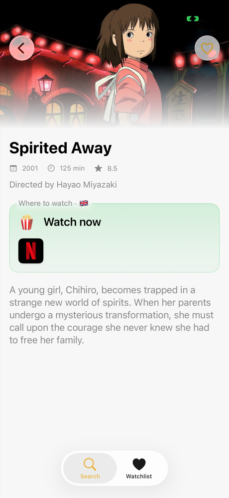
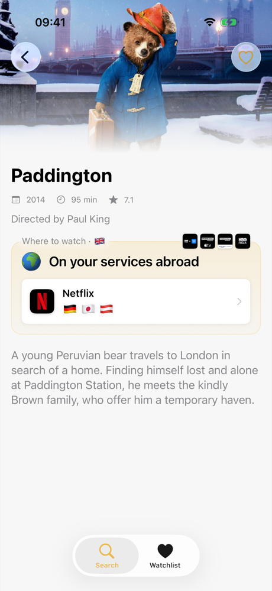
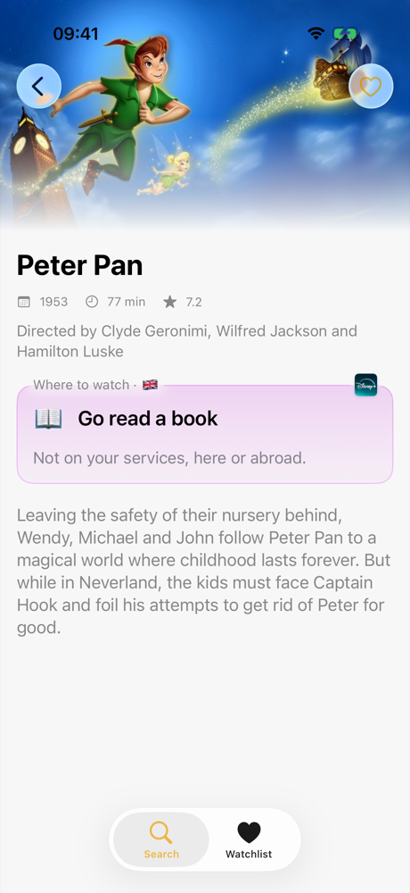
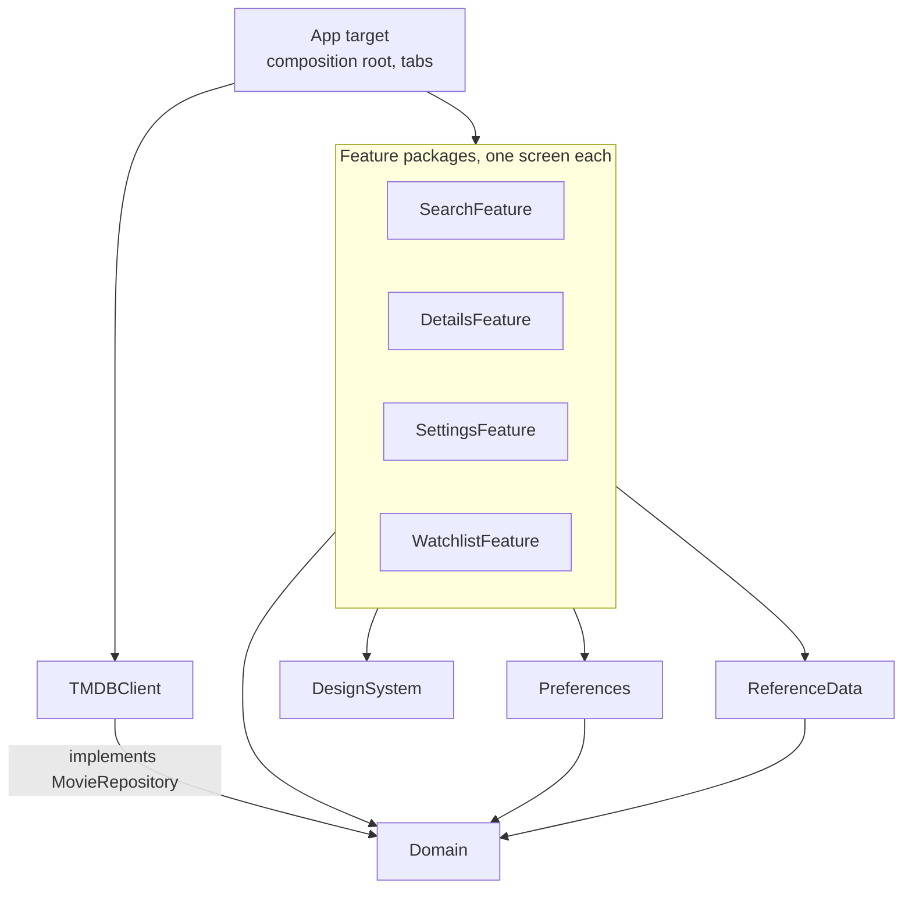

# StreamIn

[](https://github.com/martingarcialopez/StreamIn/actions/workflows/ci.yml)

Search a movie and see where you can stream it: in your country, and on the
services you already pay for in other countries — the VPN use case.

StreamIn is for people who watch on free and subscription services. It runs on
iPhone and iPad (iOS 26), in English and Spanish.

Details answers "can I watch this?" first, with one of three verdicts:

| 🍿 Watch now | 🌍 On your services abroad | 📖 Go read a book |
|:---:|:---:|:---:|
|  |  |  |
| One of your services, or a free one, has it in your country. | Not at home, but your services carry it in other countries. | Not on your services, here or abroad. |

## Status

In development, with an App Store release as the goal. Work ships in roadmap
phases, one reviewed pull request each.

**Works today**

- Search, with each result's streaming services in your region filling in as they arrive.
- Details: one verdict on where you can watch it, in your region or on *your* services in other countries.
- Onboarding and Settings to pick your services (home region or worldwide), region and language.
- English and Spanish, switchable in the app.
- Session caching, so going back and forth between screens doesn't refetch.

**Next:** the Watchlist (SwiftData), landing-page polish, and App Store
readiness (icon, privacy manifest, attribution screens).

## Quick start

Requires Xcode 26 (built with 26.6) and an iOS 26.2 or later simulator.

1. Clone the repo.
2. Get a free TMDB API key at <https://developer.themoviedb.org/>.
3. Create the local secrets files (both gitignored) and enable the repo's git hooks, then put your key in `Secrets.xcconfig`:

   ```bash
   scripts/setup.sh
   ```

4. Open `StreamIn.xcodeproj`, pick the `StreamIn` scheme and run it on an iPhone or iPad simulator.

A build step turns `Secrets.xcconfig` into `StreamIn/Secrets/GeneratedSecrets.swift`.
After changing the key, clean the build folder (⇧⌘K).

**Tests.** Press ⌘U on the `StreamIn` scheme: its test plan
(`StreamIn.xctestplan`) runs every package's tests in one build. From the command
line, the same run CI makes:

```bash
xcodebuild test -project StreamIn.xcodeproj -scheme StreamIn -testPlan StreamIn -destination 'platform=iOS Simulator,name=iPhone 17,OS=latest'
```

The packages are iOS-only, so `swift test` can't run them on macOS.

**Debugging network traffic.** Launch with `STREAMIN_DISABLE_CACHE=1` (scheme →
Run → Environment Variables) to send every request over the network, for a proxy
such as Proxyman.

## Architecture

One Swift package per layer, so the boundaries are checked by the compiler.



| Package | Depends on | Holds |
|---|---|---|
| `Domain` | — | Entities, value types (`Region`, `Language`, typed IDs), the `MovieRepository` protocol, `MovieError` |
| `TMDBClient` | Domain | HTTP client, DTOs, the TMDB adapter and the caching decorator |
| `Preferences` | Domain | User settings (region, language, subscriptions), stored in UserDefaults |
| `ReferenceData` | Domain | `ProviderCatalog`: every provider's name and logo, loaded at launch |
| `DesignSystem` | — | Spacing, radius and logo-size tokens, SF Symbol names, colors, `ProviderLogo`, `RemoteImage` |
| `SearchFeature`, `DetailsFeature`, `SettingsFeature`, `WatchlistFeature` | Domain, DesignSystem (+ Preferences, ReferenceData) | One screen each, with its view model |
| App (`StreamIn/`) | everything | Composition root (`StreamInApp`), `RootView`, tab containers |

**The rule that matters most: features depend on Domain protocols, never on
TMDBClient or SwiftData.** A feature's `Package.swift` doesn't list TMDBClient, so
importing it doesn't compile. That keeps the app testable without a network and
the data source swappable.

Planned: a `Persistence` package for the SwiftData watchlist store.

## Key decisions

**TMDB as the only data source.** Streaming services have no public availability
APIs. The realistic options are aggregators; TMDB is free, well documented, and its
watch-provider data comes from JustWatch, the same source the paid APIs use.

**Swift concurrency end to end.** async/await throughout, no Combine.
- Details loads the movie and its availability in parallel with `async let`.
- Search fans out one availability request per result in a task group, so each
  row fills in as its answer arrives.
- Screens re-run their work with `.task(id:)` when the query, region or language
  changes; SwiftUI cancels the previous run, and view models ignore results from a
  run that was superseded.

**Caching, one mechanism per kind of data.**
- Provider names and logos are reference data, loaded at launch into
  `ProviderCatalog` and read synchronously, so screens render complete on their
  first frame.
- Responses go through `CachingMovieRepository`, backed by a `MemoryCache` actor
  that stores in-flight *tasks*: concurrent callers share one request, and
  failures are never cached. Search and movie details last the session;
  availability expires after 30 minutes. A cancelled caller's result is thrown
  away, but the shared request still finishes and lands in the cache for the
  next caller.
- Provider logos go through `RemoteImageStore`, an in-memory image cache, because
  `AsyncImage` always starts on its placeholder.

**Typed errors at the boundary.** `MovieError` lists the states a user can see
(offline, timeout, rate limited, not found…). Network and decoding errors are
mapped into it inside TMDBClient, so views switch over it exhaustively.

**One provider per brand.** TMDB uses several IDs for one service (Netflix and
its ad tier, Prime Video's regional IDs). `ProviderAliases` groups them, so the
app shows one Netflix and matches your subscription in every country.

**Hand-rolled dependency injection.** `StreamInApp.init()` is the only place
concrete types are built. View models receive their dependencies through `init`.
No DI framework.

**Localization per package.** Each package owns a String Catalog in English and
Spanish, with generated symbols (`Text(.searchPrompt)`) so a missing key fails
the build. The in-app language picker changes both the interface and TMDB's
content, and asks for a restart because iOS loads the interface language at
launch.

**Out of scope for v1.** Rent and buy prices aren't shown: the audience watches
on free and subscription services. The data stays in the domain model.

## Testing

Unit tests use Swift Testing, in every package:

- **Domain:** provider alias groups and merging, region flags, language matching.
- **TMDBClient:** DTO-to-domain mapping and alias merging against a stubbed
  client; the response cache's request sharing, expiry (with an injected clock)
  and failure handling.
- **View models** against fake repositories: search (repeated requests, partial
  retries, region and language changes), details (load states, failures,
  cancellation), the streaming-services picker.
- **ReferenceData, Preferences, DesignSystem:** catalog loading, persistence,
  the image store.

**CI** ([`ci.yml`](.github/workflows/ci.yml)) builds the app and runs the whole
test plan on a clean macOS runner for every pull request and every push to
`main`, with per-package test results and line coverage in the job summary. A
pull request can't merge until it's green.

Coverage (Oct 2026) is high where the logic lives — the caches, provider aliases,
the search and details view models, preferences and the provider catalog sit
between 73% and 100% — and low in SwiftUI views, which previews check instead.
The TMDB adapter is the gap ([#14](https://github.com/martingarcialopez/StreamIn/issues/14)).

Not written yet: network fixture tests for `LiveTMDBClient` (`URLProtocol`) and a
UI test for search → details → providers.

## How it's built: Claude Code

StreamIn is also where I learn to build with AI agents, so the workflow is part
of the project and lives in the repo:

- **[CLAUDE.md](CLAUDE.md)** — architecture, conventions and settled decisions,
  loaded into every session.
- **Path-scoped rules** ([`.claude/rules/`](.claude/rules)) — the Swift/SwiftUI
  guide, localization and secrets, loaded only when matching files are touched.
- **Issues first** — each roadmap phase is a milestone and its tasks are issues
  with acceptance criteria. A pull request closes its issue; small issues can go
  straight to claude[bot] with the `claude` label.
- **Skills** ([`.claude/skills/`](.claude/skills)) — `start-issue` (read an issue,
  plan, branch), `localize` (add a string in en + es and regenerate symbols),
  `new-package` (scaffold a package and register it in the Xcode project),
  `commit`, and `ship-phase` (review → local check → log → PR → CI). `localize`
  and `new-package` wrap tested scripts rather than prose instructions.
- **Hooks** — protect generated and secret files, regenerate string symbols after
  catalog edits, lint `project.pbxproj` after edits, and warn when the main
  checkout that sessions load from is stale. Keeping `main` safe is left to
  GitHub's branch protection, plus a small git `pre-commit` hook
  ([`.githooks/`](.githooks)).
- **A reviewer subagent** ([`ios-reviewer`](.claude/agents/ios-reviewer.md)) —
  read-only review against the project rules before every pull request.
- **Xcode's MCP server** ([`.mcp.json`](.mcp.json)) — the agent builds, runs tests
  and renders previews itself.
- **On GitHub** — macOS CI is the source of truth for build and tests: agents
  quote its run instead of their own. `@claude` in a pull request or issue gets
  an answer or a fix, an issue labeled `claude` gets implemented in a pull
  request, and each new pull request gets an automated review.

The [workflow log](docs/workflow-log.md) records each change to the workflow and
what it actually improved, including what didn't work. Next: a visual check
before every pull request, parallel agents in worktrees, and evals for the skills
and the reviewer.

## Non-goals

No accounts, social features, video playback, analytics, iCloud sync or
iPad-specific layouts. AI features inside the app only if they add real value
for users.

## Project structure

```
StreamIn/
├── StreamIn/              App target: App/ (composition root, tabs), Resources/, Secrets/
├── Packages/
│   ├── Domain/
│   ├── TMDBClient/
│   ├── Preferences/
│   ├── ReferenceData/
│   ├── DesignSystem/
│   ├── SearchFeature/
│   ├── DetailsFeature/
│   ├── SettingsFeature/
│   └── WatchlistFeature/  Placeholder until the Watchlist phase
├── StreamInTests/         App-level test targets (templates for now)
├── StreamInUITests/
├── .claude/               Shared Claude Code setup
├── .github/               Pull request template, Claude workflows
└── docs/workflow-log.md
```

## Acknowledgements

Movie data and watch-provider data courtesy of
[The Movie Database (TMDB)](https://www.themoviedb.org/). This product uses the
TMDB API but is not endorsed or certified by TMDB. Streaming availability data is
provided by [JustWatch](https://www.justwatch.com/).
